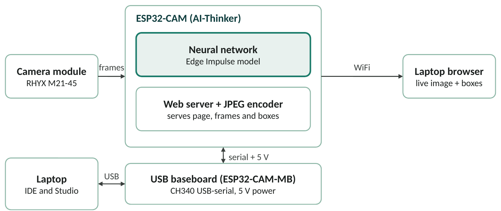

# ESP32-CAM Object Detection with Edge Impulse (TinyML)

Object detection that runs **on an ESP32-CAM board**. The photos are captured with the board itself, labeled and trained in [Edge Impulse](https://edgeimpulse.com), and the trained model runs on the microcontroller. Detections are shown in the Serial Monitor and as boxes drawn over a live image in a web browser.

This is a B.Sc. Electronics (third year) project. It documents what worked, what did not, and how the problems were solved, including a camera sensor that has no hardware JPEG output.



## Features

- Runs the neural network fully on the ESP32-CAM, with no cloud service at run time
- Web page for capturing a labeled dataset with the same camera (type a name, click Save)
- Live detection page with a box and label over each detection
- Combined sketch: detection and photo capture on one page
- Works around sensors without JPEG support: RGB565 capture with software JPEG conversion

## Hardware

| Part | Notes |
|---|---|
| ESP32-CAM (AI-Thinker layout) | Camera pin map is in the sketches |
| ESP32-CAM-MB USB baseboard | CH340 USB-serial chip, 5 V power, handles boot mode |
| Camera module | Tested with a **RHYX M21-45** module (no hardware JPEG) |
| Laptop and 2.4 GHz WiFi | WiFi is needed for the web pages. 5 GHz-only networks do not work |

## Software

- Arduino IDE with the ESP32 board package (Espressif)
- An Edge Impulse account (free)
- CH340 USB driver on Windows

## Repository structure

```
firmware/
  camera_test/        Starts the camera in RGB565 and prints frame info to Serial
  data_collection/    Web page to capture and download labeled photos
  detect_serial/      Live detection, results printed to the Serial Monitor
  detect_web/         Live detection with boxes drawn in a browser page
  detect_and_collect/ Detection and photo capture on one page
docs/
  workflow.md         Step-by-step workflow, including the Edge Impulse settings
  troubleshooting.md  Problems met during the project and their fixes
  images/             Diagram and screenshots
model/
  README.md           How to export and install the trained model library
```

The Edge Impulse model library is **not included**. You train your own model and install it as described in `model/README.md`.

## Quick start

1. **Set up the Arduino IDE.** Install the ESP32 board package, then choose **Tools > Board > AI Thinker ESP32-CAM**, set **PSRAM** to *Enabled* and **Partition Scheme** to *Huge APP*. Use **115200** baud in the Serial Monitor.
2. **Test the camera.** Upload `firmware/camera_test`. You should see `Camera init SUCCESS` and a line per captured frame.
3. **Collect photos.** In `firmware/data_collection`, set your WiFi name and password, upload, open the IP printed in the Serial Monitor, type an object name, and click **Save photo**. Collect about 40 to 60 background-only photos (name them `background`) and 80 or more varied photos of the object.
4. **Train in Edge Impulse.** Create an object detection project, upload the photos, draw tight boxes on the objects (leave background photos without boxes), build an impulse with a 96 x 96 image block, train, and check *Model testing*.
5. **Export the model.** Build the **Arduino library** (quantized int8 is the safer choice) and install the .zip with *Sketch > Include Library > Add .ZIP Library*.
6. **Run detection.** In the `detect_*` sketches, change the `#include <..._inferencing.h>` line to the name of your library, set your WiFi if needed, and upload. Then open the Serial Monitor or the browser page.

More detail is in [`docs/workflow.md`](docs/workflow.md).

## Results

| Run | Training data | Result |
|---|---|---|
| 1 | 17 images, one class | F1 score 0. The model predicted background everywhere |
| 2 | 44 images | F1 score about 41 % |
| Live test (run 2 model) | | Detections at 88 to 97 % confidence even with nothing in front of the camera |


*Live Serial Monitor output with nothing in front of the camera.*

The pipeline works from capture to live detection on the board. The model itself is not yet reliable: the training set had no background-only photos and little variety, which is the likely cause of the false detections. This explanation has not yet been confirmed by retraining.

## Known issues and notes

- **No hardware JPEG on the tested sensor.** The stock camera examples fail with `JPEG format is not supported on this sensor` (error 0x106). These sketches use RGB565 at 320 x 240 and convert frames to JPEG in software. With a sensor that supports hardware JPEG, the stock examples may work, but these sketches have only been tested with the RHYX M21-45.
- **Keep the camera setup the same** for collecting photos and for detection (distance, focus, 320 x 240 frame size).
- **Speed.** Each frame needs a model run and a software JPEG conversion, so detection is slow (roughly one frame per second or slower in this setup; not measured precisely).
- **Memory.** WiFi, the model and the camera together use most of the board's memory. If the web sketches fail to start, use `detect_serial`.
- **The first compile is slow** (often several minutes) because of the model library.

See [`docs/troubleshooting.md`](docs/troubleshooting.md) for the full list.

## Security note

The sketches contain `YOUR_WIFI_NAME` and `YOUR_WIFI_PASSWORD` placeholders. **Never commit your real WiFi credentials.** Edit them locally before uploading, and do not push those edits.

## Future work

1. Add 40 to 60 background-only photos and 80 to 100 varied object photos, retrain, and compare F1 scores
2. Add more object classes one at a time
3. Compare grayscale and RGB input, and raise the training cycles
4. Raise the confidence cutoff and measure false detections on empty scenes
5. Try a genuine OV2640 camera module with hardware JPEG
6. Add a display or buzzer for stand-alone alerts

## References

1. P. Warden and D. Situnayake, *TinyML*, O'Reilly Media, 2019.
2. A. G. Howard et al., "MobileNets: Efficient Convolutional Neural Networks for Mobile Vision Applications," arXiv:1704.04861, 2017.
3. B. Jacob et al., "Quantization and Training of Neural Networks for Efficient Integer-Arithmetic-Only Inference," CVPR, 2018.
4. Edge Impulse documentation: https://docs.edgeimpulse.com
5. Espressif esp32-camera driver: https://github.com/espressif/esp32-camera

## License

Released under the MIT License. See [`LICENSE`](LICENSE).

## Author

Vivek Nikole, B.Sc. Mathematics, Institute Of Science,Nagpur
